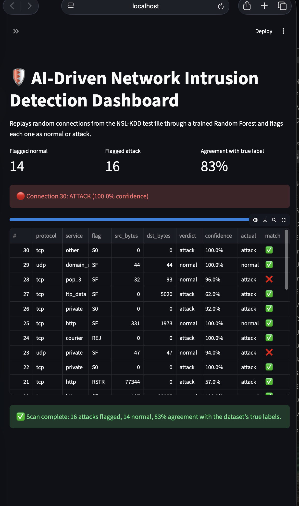

# AI-Driven Network Intrusion Detection System

A machine-learning system that classifies network connections as **normal** or **attack**, trained on the NSL-KDD dataset with a Random Forest, and paired with a Streamlit dashboard that simulates live traffic monitoring.

Built entirely on a MacBook with free tools, no hardware needed.



## Results

Evaluated on a held-out 20% test split (25,195 connections, stratified):

| Metric    | Score  |
|-----------|--------|
| Accuracy  | 99.90% |
| Precision | 99.94% |
| Recall    | 99.84% |
| F1-score  | 99.89% |

Confusion matrix:

|                | Predicted normal | Predicted attack |
|----------------|-----------------:|-----------------:|
| **Actual normal** | 13,462 | 7 |
| **Actual attack** | 19 | 11,707 |

Only 19 attacks were missed out of 11,726, and 7 normal connections were wrongly flagged out of 13,469.

> NSL-KDD is a cleaned benchmark dataset, so scores this high are expected. Real-world traffic is noisier and would score lower. See Limitations below.

The dashboard replays random rows from the separate `KDDTest+.txt` file, which includes attack types the model never saw in training. Agreement with the true labels there is lower (around 83% in the scan shown above), which shows how much performance drops when the data shifts.

## What the model learned

The top features by Random Forest importance:

| Feature | What it means |
|---------|---------------|
| `src_bytes` | Bytes sent from source to destination. Attacks tend to send unusually large or near-empty payloads. |
| `flag_SF` | A connection that opened and closed normally. Attacks often leave connections in abnormal states such as `S0`. |
| `dst_bytes` | Bytes sent back from the destination. |
| `logged_in` | Whether the connection authenticated successfully. |
| `dst_host_same_srv_rate`, `same_srv_rate` | How repetitive traffic is toward the same service, a typical sign of DoS floods. |
| `protocol_type_icmp` | ICMP traffic, common in ping floods and reconnaissance sweeps. |

## How it works

1. **Load**: read `KDDTrain+.txt` with 41 named features, a label, and a `difficulty_level` column.
2. **Clean**: collapse the 23 specific attack labels into a binary target (`normal` / `attack`), drop `difficulty_level`, and one-hot encode `protocol_type`, `service`, and `flag` (43 columns become 122 features).
3. **Train**: 80/20 stratified split, then a scikit-learn `RandomForestClassifier`.
4. **Evaluate**: accuracy, precision, recall, F1, confusion matrix, and a feature-importance chart.
5. **Save**: the model is stored with `joblib` for the dashboard to load.
6. **Dashboard**: a Streamlit app applies the same cleaning and encoding to random test rows, then shows each verdict (normal or attack) with a confidence score, the true label, and running counts.

## Project structure

```
ai-nids-project/
├── nids_pipeline.ipynb     # load, clean, train, evaluate, save model
├── app.py                  # Streamlit dashboard
├── feature_columns.csv     # feature order the model expects
├── screenshots/
│   └── dashboard.png
├── requirements.txt
└── README.md
```

The dataset files and the trained model (`nids_model.pkl`) are not committed. Follow the steps below to recreate them.

## Run it yourself

**1. Install dependencies**
```bash
python3 -m venv nidsenv
source nidsenv/bin/activate
pip install -r requirements.txt
```

**2. Get the dataset**

Download `KDDTrain+.txt` and `KDDTest+.txt` (NSL-KDD) and place them in the project folder. A GitHub mirror is [jmnwong/NSL-KDD-Dataset](https://github.com/jmnwong/NSL-KDD-Dataset).

**3. Train the model**

Open `nids_pipeline.ipynb` and run all cells. This trains the Random Forest and creates `nids_model.pkl` and `feature_columns.csv`.

**4. Launch the dashboard**
```bash
streamlit run app.py
```
Open the sidebar, choose how many connections to scan, and click **Start Live Scan**.

## Tech stack

Python, pandas, scikit-learn, matplotlib, joblib, Streamlit, Jupyter.

## Limitations

- NSL-KDD is an older, cleaned benchmark. Performance on modern, real-world traffic would be lower.
- The model uses pre-computed connection features, not raw packets, so it can't inspect live traffic directly.
- The task is binary (normal vs attack). It doesn't name the attack type (DoS, Probe, R2L, U2R).
- The dashboard replays dataset rows to simulate monitoring. It is not connected to a live network.

## What I learned

- Debugging data pipelines: a silent one-column shift (a 43rd `difficulty_level` column) corrupted every feature until I inspected `df.head()` instead of trusting `df.info()`.
- Why accuracy alone isn't enough for security: a missed attack (false negative) costs more than a false alarm, so recall and the confusion matrix matter.
- Reading a model instead of treating it as a black box: feature importances line up with networking concepts like connection flags, byte volumes, and service repetition.
- Separating training from serving: saving the model and feature order so a dashboard can load it independently.
- Distribution shift: the model scores 99.9% on a split of its own training file but noticeably lower on the harder test file.

## Possible next steps

- Multi-class detection of specific attack types
- Measure accuracy on the full `KDDTest+.txt` file, not just a sample of 30 rows
- Try a newer dataset such as CICIDS2017
- Replay captured packets (pcap files) through a feature extractor for a more realistic demo
